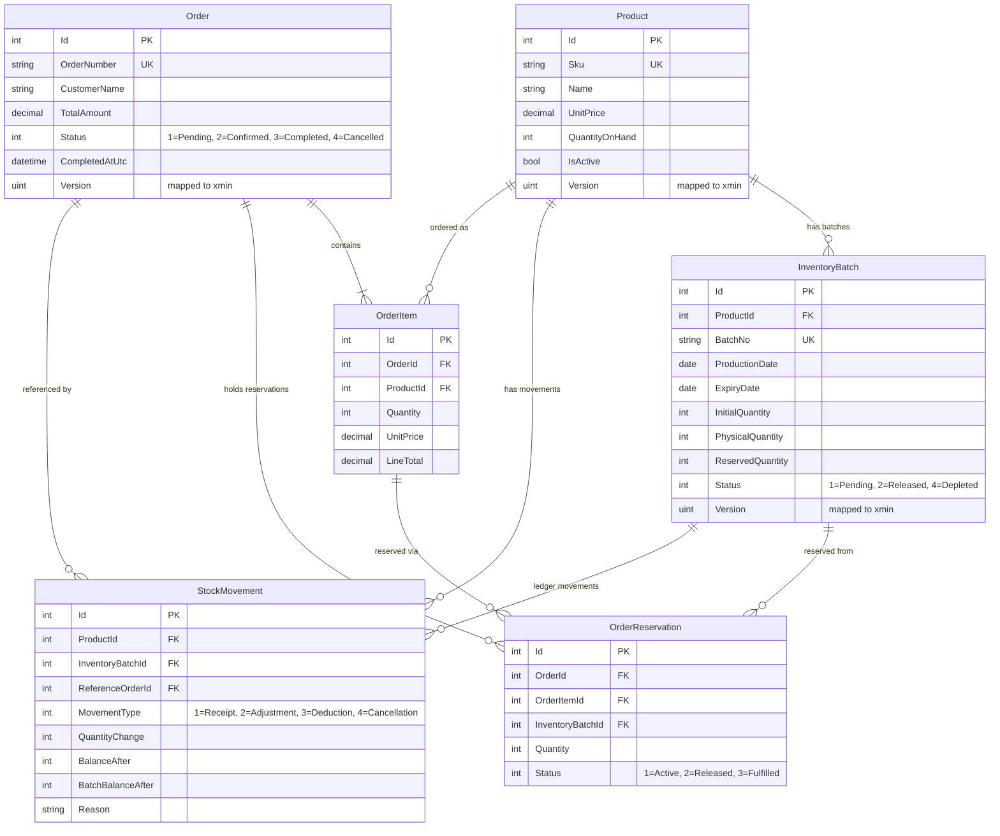
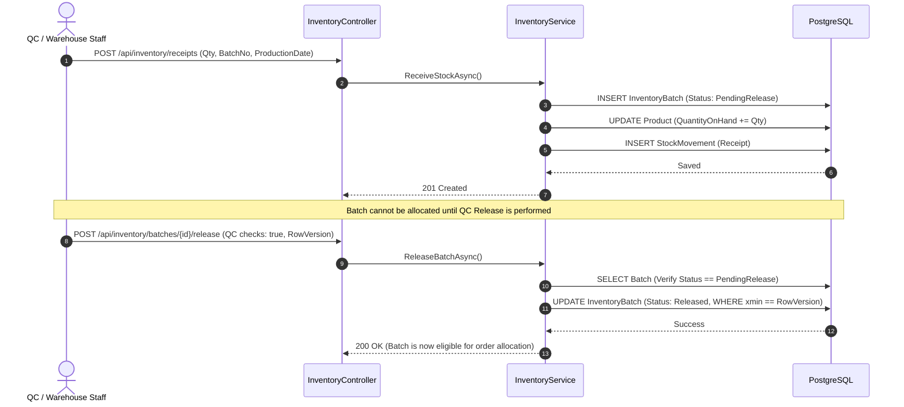
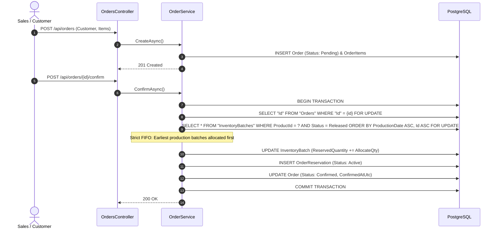
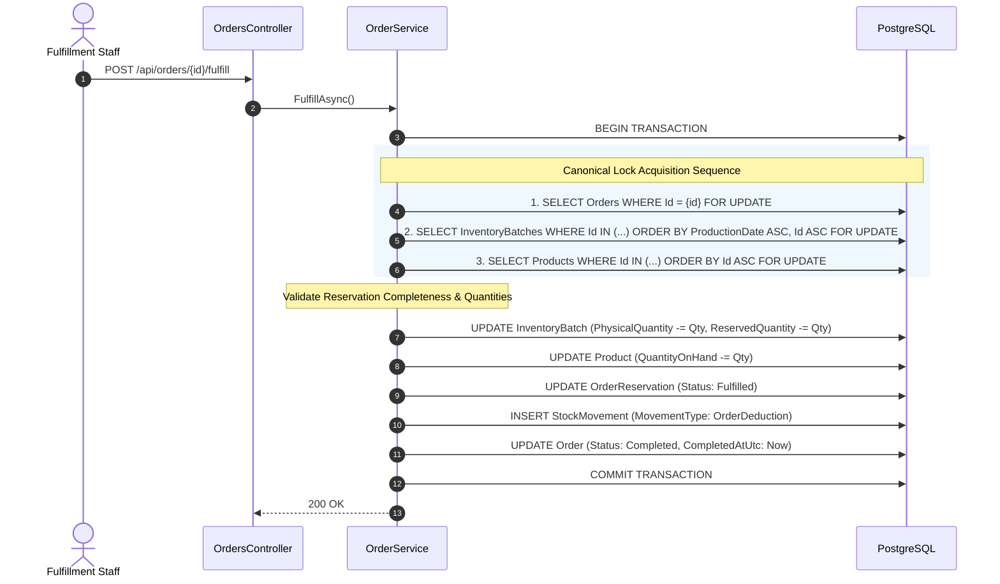
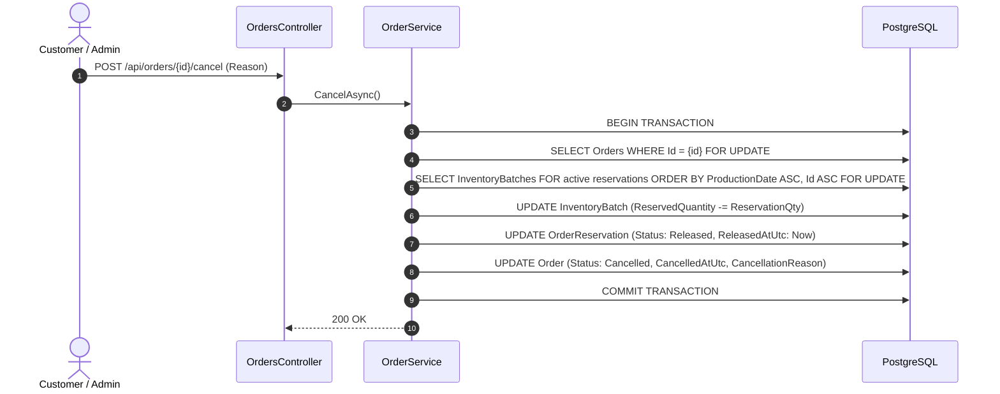

# AbonStock Architecture & Concurrency Design

This document describes the architectural patterns, relational data models, transaction boundaries, and concurrency controls implemented in **AbonStock**.

---

## 1. Architectural Overview & Component Responsibilities

AbonStock follows an idiomatic layered ASP.NET Core Web API architecture with Entity Framework Core and PostgreSQL.

```
┌───────────────────────────────────────────────────────────┐
│                    HTTP Requests (JSON)                   │
└─────────────────────────────┬─────────────────────────────┘
                              ▼
┌───────────────────────────────────────────────────────────┐
│                 Controllers & Routing                     │
│  (ProductsController, InventoryController, OrdersController) │
└─────────────────────────────┬─────────────────────────────┘
                              ▼
┌───────────────────────────────────────────────────────────┐
│                 Global Exception Handling                 │
│        (RFC 7807 ProblemDetails, DB Code Mapping)         │
└─────────────────────────────┬─────────────────────────────┘
                              ▼
┌───────────────────────────────────────────────────────────┐
│                    Application Services                   │
│      (ProductService, InventoryService, OrderService)     │
└─────────────────────────────┬─────────────────────────────┘
                              ▼
┌───────────────────────────────────────────────────────────┐
│              Data Access & State Management               │
│      (AbonStockDbContext, Change Tracker, Migrations)     │
└─────────────────────────────┬─────────────────────────────┘
                              ▼
┌───────────────────────────────────────────────────────────┐
│                  PostgreSQL 16 Engine                     │
│ (Row-level Locks FOR UPDATE, Advisory Locks, xmin Tokens) │
└───────────────────────────────────────────────────────────┘
```

### Component Responsibilities:
- **Controllers (`AbonStock.Api.Controllers`):** Handle HTTP routing, model binding, and HTTP status code dispatch (`200 OK`, `201 Created`, `400 Bad Request`, `404 Not Found`, `409 Conflict`).
- **Services (`AbonStock.Api.Services`):** Encapsulate all business rules, transaction orchestration, deterministic lock acquisition, and inventory invariants.
- **DbContext (`AbonStock.Api.Data`):** Configures entity mappings, check constraints, partial unique indexes, and PostgreSQL `xmin` concurrency tokens.
- **Middleware (`AbonStock.Api.Middleware`):** Intercepts domain and database exceptions (`PostgresException`, `DbUpdateConcurrencyException`), transforming them into standard RFC 7807 `ProblemDetails` responses.

---

## 2. Relational Domain Model & ERD

The domain models center around physical batch traceability and order allocation:



### Entity Enums & Representations:
- **`BatchStatus`:** `PendingRelease (1)`, `Released (2)`, `Quarantined (3)`, `Depleted (4)`
- **`OrderStatus`:** `Pending (1)`, `Confirmed (2)`, `Completed (3)`, `Cancelled (4)`
- **`ReservationStatus`:** `Active (1)`, `Released (2)`, `Fulfilled (3)`
- **`StockMovementType`:** `Receipt (1)`, `Adjustment (2)`, `OrderDeduction (3)`, `OrderCancellation (4)`

---

## 3. Core Lifecycle Workflows

### Workflow 1: Batch Receipt & QC Release


---

### Workflow 2: Order Creation & FIFO Reservation
When an order is created, it remains in `Pending` state. No inventory is reserved until order confirmation:



---

### Workflow 3: Atomic Order Fulfillment
Fulfillment transitions the order from `Confirmed` to `Completed`, simultaneously consuming physical stock and reserved stock:



---

### Workflow 4: Order Cancellation & Reservation Release
If a `Confirmed` order is cancelled before fulfillment, active reservations are immediately rolled back:



---

## 4. FIFO Inventory Allocation Strategy

> [!IMPORTANT]
> AbonStock strictly utilizes **FIFO (First-In, First-Out)** batch allocation ordered by `ProductionDate ASC, Id ASC`. It does **not** use FEFO (First-Expired, First-Out).

The candidate query used during `ConfirmAsync` is:
```sql
SELECT *, "xmin" FROM "InventoryBatches"
WHERE "ProductId" = @pProductId
  AND "Status" = 2 -- Released
  AND "PhysicalQuantity" > "ReservedQuantity"
  AND ("ExpiryDate" IS NULL OR "ExpiryDate" >= @pToday)
ORDER BY "ProductionDate" ASC, "Id" ASC
FOR UPDATE;
```

### Deterministic Tie-Breaking:
If multiple batches share the same production date, the primary key `Id ASC` is used as an immutable tie-breaker. This guarantees that concurrent allocation operations consistently evaluate batches in the exact same sequence.

---

## 5. Canonical Lock Hierarchy & Deadlock Prevention

Concurrent operations touching overlapping sets of resources can lead to database deadlocks if rows are locked in inconsistent orders.

To guarantee zero circular waits, **AbonStock enforces a strict three-tier canonical lock hierarchy**:

$$\text{Orders} \longrightarrow \text{InventoryBatches} \longrightarrow \text{Products}$$

### Lock Acquisition Order:
1. **Tier 1 — Order Row Lock:**
   Acquired first via `SELECT "Id" FROM "Orders" WHERE "Id" = {id} FOR UPDATE`.
   This serializes any competing operations (e.g., simultaneous confirm, fulfill, or cancel on the same order).
2. **Tier 2 — Inventory Batch Row Locks:**
   Candidate batches are locked in deterministic order:
   `ORDER BY "ProductionDate" ASC, "Id" ASC FOR UPDATE`.
3. **Tier 3 — Product Row Locks:**
   Associated products are locked in deterministic primary key order:
   `ORDER BY "Id" ASC FOR UPDATE`.

Because `ConfirmAsync`, `CancelAsync`, and `FulfillAsync` strictly adhere to this exact sequence, circular-wait lock graphs are mathematically prevented.

---

## 6. Stock Invariants & Mathematical Ledger Integrity

AbonStock guarantees that physical and reserved stock levels satisfy strict mathematical invariants at all times:

### 1. Aggregate Product Quantity Consistency:
For every product $P$:
$$\text{Product.QuantityOnHand} = \sum_{B \in \text{Batches}(P),\ \text{Status} \neq \text{Depleted}} B.\text{PhysicalQuantity}$$

### 2. Batch Reservation Consistency:
For every inventory batch $B$:
$$B.\text{ReservedQuantity} = \sum_{R \in \text{Reservations}(B),\ \text{Status} = \text{Active}} R.\text{Quantity}$$

### 3. Non-Negative Available Inventory:
For every batch $B$:
$$B.\text{AvailableQuantity} = B.\text{PhysicalQuantity} - B.\text{ReservedQuantity} \ge 0$$

### 4. Database Check Constraints:
These invariants are defended in depth through PostgreSQL check constraints:
- `CK_Products_UnitPrice_NonNegative`: `"UnitPrice" >= 0`
- `CK_Products_QuantityOnHand_NonNegative`: `"QuantityOnHand" >= 0`
- `CK_InventoryBatches_PhysicalQuantity_NonNegative`: `"PhysicalQuantity" >= 0`
- `CK_InventoryBatches_InitialQuantity_Positive`: `"InitialQuantity" > 0`
- `CK_InventoryBatches_ReservedQuantity_Valid`: `"ReservedQuantity" >= 0 AND "ReservedQuantity" <= "PhysicalQuantity"`
- `CK_OrderItems_Quantity_Positive`: `"Quantity" > 0`
- `CK_OrderReservations_Quantity_Positive`: `"Quantity" > 0`

---

## 7. Prevention of Double Deduction & Double Fulfillment

Double fulfillment (accidentally decrementing stock twice for the same order) is defended at two architectural boundaries:

### Layer 1: Application State Machine Guard
Fulfillment requires that `order.Status == OrderStatus.Confirmed`. Once fulfilled, `order.Status` transitions immediately to `OrderStatus.Completed`. Any duplicate or retry request encounters:
```csharp
if (order.Status != OrderStatus.Confirmed)
{
    throw new ConflictException(
        $"Order '{order.OrderNumber}' cannot be fulfilled because it is in status '{order.Status}'.");
}
```
Resulting in an immediate `409 Conflict` response.

### Layer 2: Storage Engine Partial Unique Index
Even if two concurrent fulfillment requests bypass the in-memory check simultaneously before commit, the database engine enforces:
```sql
CREATE UNIQUE INDEX "IX_StockMovements_Order_Batch_Deduction" 
ON "StockMovements" ("ReferenceOrderId", "InventoryBatchId") 
WHERE "ReferenceOrderId" IS NOT NULL 
  AND "InventoryBatchId" IS NOT NULL 
  AND "MovementType" = 3; -- 3 = OrderDeduction
```
The second transaction will trigger PostgreSQL error code `23505` (`unique_violation`), causing EF Core to rollback the transaction and the API to return `409 Conflict`.

---

## 8. Error Handling & RFC 7807 Problem Details

All exceptions are intercepted by `GlobalExceptionHandler` implementing ASP.NET Core 8 `IExceptionHandler`:

| Exception Type | Trigger Cause | HTTP Status | Title |
| :--- | :--- | :---: | :--- |
| `ValidationException` | Invalid payload, non-positive quantity, empty strings | `400 Bad Request` | `Validation Failed` |
| `PostgresException` (CheckViolation) | Database check constraint violated | `400 Bad Request` | `Invariant Violation` |
| `NotFoundException` | Entity ID does not exist in database | `404 Not Found` | `Not Found` |
| `ConflictException` | Invalid state transition, insufficient stock | `409 Conflict` | `Conflict` |
| `DbUpdateConcurrencyException` | Stale `xmin` version token detected | `409 Conflict` | `Concurrency Conflict` |
| `PostgresException` (UniqueViolation) | Duplicate SKU, duplicate batch, or double deduction | `409 Conflict` | `Unique Constraint Violation` |
| Unhandled Exceptions | Internal server errors | `500 Internal Server Error` | `Internal Server Error` |

---

## 9. Architectural Limitations (Milestone 1)

1. **Monolithic In-Process Transaction Scope:**
   Transactions span relational boundaries in a single PostgreSQL database. Distributed transactions (Saga / Outbox) are not included.
2. **Synchronous Fulfillment:**
   Fulfillment happens synchronously inside the request pipeline. For high-scale batch operations, asynchronous processing via a message broker (RabbitMQ / Kafka) would be suited for Milestone 2.
3. **Audit Immutability:**
   Stock movements are append-only. There is currently no database trigger physically preventing manual `UPDATE` or `DELETE` on `StockMovements` by database superusers.
